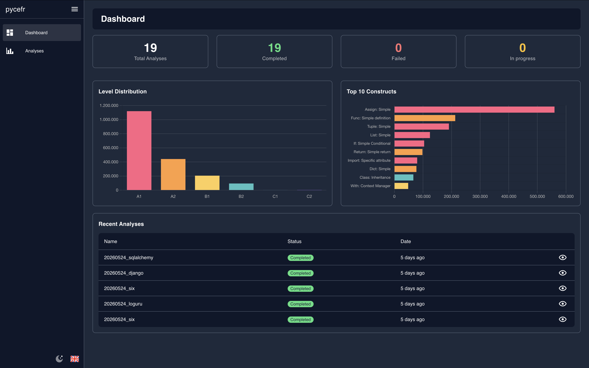
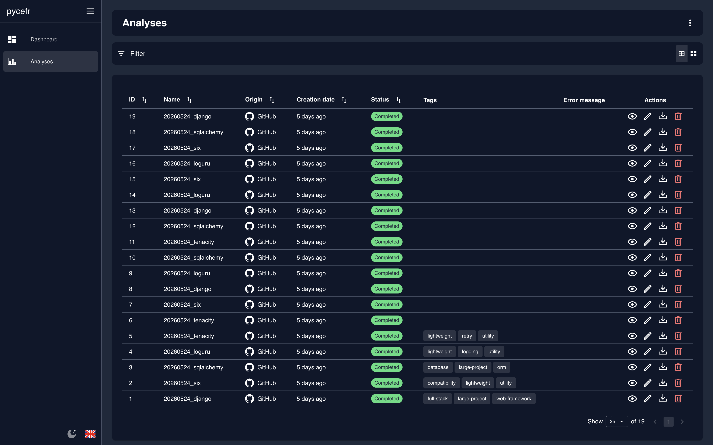
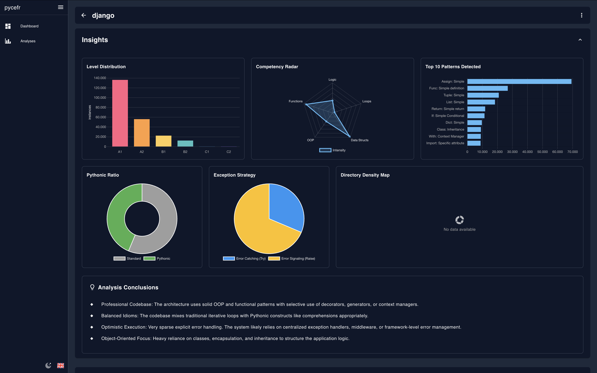
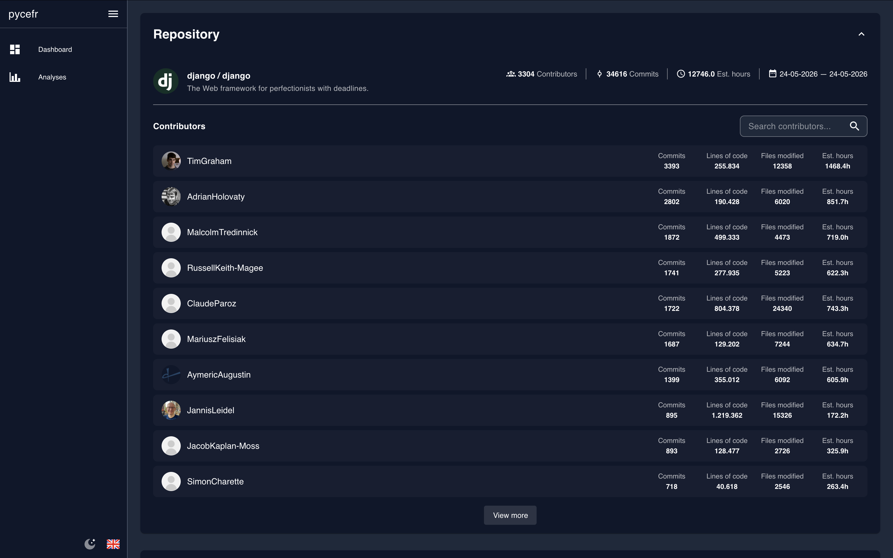
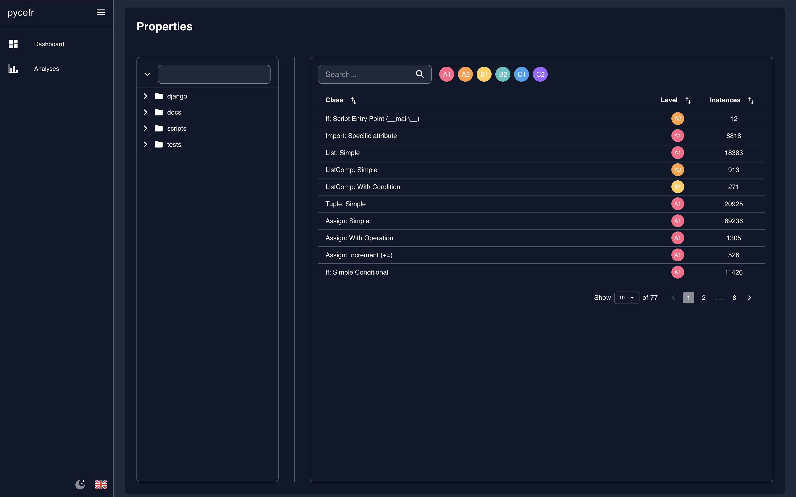

# PyCEFR


**Analyse Python repositories and classify code constructs using CEFR-inspired proficiency levels (A1 - C2).**

PyCEFR parses the AST of every Python file in a project and maps each language construct (list comprehensions, decorators, generators, metaclasses, etc.) to a proficiency level inspired by the [Common European Framework of Reference for Languages](https://en.wikipedia.org/wiki/Common_European_Framework_of_Reference_for_Languages). The result is a per-file and per-contributor breakdown showing how "advanced" the codebase is.

---

## Features

- Analyse any public GitHub repository by URL
- Classify ~93 Python language constructs into levels A1 through C2
- Per-contributor statistics: commits, lines of code, estimated development hours
- Interactive dashboard with charts (bar, radar, doughnut, treemap)
- File-level drill-down with level filtering
- Export / import analyses as JSON
- CLI mode for local directories and GitHub repos

## Screenshots

### Dashboard


### Analysis List


### Analysis Details






## Tech Stack

| Layer          | Technology                                               |
| -------------- | -------------------------------------------------------- |
| Backend        | Python 3.11+, FastAPI, Pydantic v2, SQLite               |
| Frontend       | Vue 3 (Composition API), TypeScript, Vuetify 3, Chart.js |
| Tooling        | Vite, ESLint, Prettier, Stylelint, Husky, Vitest         |
| Infrastructure | Docker, Docker Compose                                   |
| API Client     | Auto-generated from OpenAPI via `@hey-api/openapi-ts`    |

## Quick Start

### Prerequisites

- Docker and Docker Compose
- A [GitHub personal access token](https://github.com/settings/tokens) (for API validation calls)

### 1. Clone and configure

```bash
git clone https://github.com/PepeM112/pycefr.git
cd pycefr
cp .env.example .env
# Edit .env and set your GitHub token:
#   API_KEY=ghp_your_github_token_here
```

### 2. Run

```bash
make up
```

This starts:
- **Backend** at [http://localhost:8000](http://localhost:8000)
- **Frontend** (Vite dev server with HMR) at [http://localhost:3000](http://localhost:3000)

### 3. Seed demo data (optional)

```bash
make seed
```

### 4. Open the app

Navigate to the frontend URL and paste a GitHub repository URL to start an analysis.

---

## Environment Variables

Create a `.env` file in the project root (or copy from `.env.example`):

```env
API_KEY=ghp_your_github_token_here
```

Optional settings (with defaults):

```env
IGNORE_FOLDERS=node_modules/,myenv/,.git/,__pycache__/
PYTHON_THRESHOLD_PERCENTAGE=50
DATABASE_PATH=database/pycefr.db
ADD_LOCAL_SUFFIX=true
AUTO_DISPLAY_CONSOLE=true
CORS_ORIGINS=http://localhost:3000,http://127.0.0.1:3000
```

| Variable                      | Description                                                   |
| ----------------------------- | ------------------------------------------------------------- |
| `IGNORE_FOLDERS`              | Comma-separated folder names excluded from analysis           |
| `PYTHON_THRESHOLD_PERCENTAGE` | Minimum % of Python code required in a repo to allow analysis |
| `DATABASE_PATH`               | Path to the SQLite database file                              |
| `ADD_LOCAL_SUFFIX`            | Append `_local` suffix to result files for local analyses     |
| `AUTO_DISPLAY_CONSOLE`        | Automatically print results to the console after CLI analysis |
| `CORS_ORIGINS`                | Comma-separated allowed CORS origins                          |

---

## CLI Usage

PyCEFR includes a standalone CLI for analysing repositories and viewing results directly in the terminal. Use `-p` to print results after analysis, or `-c` to view previously saved results.

### Native (local install)

```bash
# Set up a virtual environment and install
python -m venv .venv
source .venv/bin/activate   # Windows: .venv\Scripts\activate
pip install -e .

# Analyse a GitHub repository
pycefr -r https://github.com/user/repo --include-repo -p

# Analyse a local directory
pycefr -d /path/to/project -p

# Analyse a GitHub user's repos (interactive selection)
pycefr -u username --include-repo -p

# List saved results
pycefr -l

# View a saved result
pycefr -c repo-name
```

Results are saved as JSON files in `./results/`.

### Via Docker

```bash
# Analyse a GitHub repository
docker compose exec backend pycefr -r https://github.com/user/repo --include-repo -p

# List saved results
docker compose exec backend pycefr -l

# View a saved result
docker compose exec backend pycefr -c repo-name
```

> **Note:** When running via Docker, results are stored inside the container at `/app/results/` and won't persist across container recreations.

---

## Development

### Available commands

```bash
make help            # Show all available commands
make up              # Start all services
make build           # Rebuild images (after dependency changes)
make down            # Stop all services
make seed            # Seed the database with demo data
make test            # Run backend tests (pytest)
make lint            # Run all linters (backend + frontend)
make lint-back       # Run backend linters (ruff + mypy)
make lint-front      # Run frontend linters (eslint + vue-tsc)
make logs            # Tail Docker logs
make shell           # Open SQLite interactive shell
make reset           # Stop services and wipe the database volume
make gen-ts          # Regenerate TypeScript client from OpenAPI schema
make clean           # Remove generated TypeScript client
```

---

## Project Structure

```
pycefr/
  backend/
    api/               # FastAPI route handlers
    config/            # Pydantic settings
    db/                # SQLite schema, seed data, CRUD utilities
    models/schemas/    # Pydantic models (analysis, repo, common)
    services/analyzer/ # Core analysis engine
      analyzer.py          # AST walker and file scanner
      cli.py               # CLI orchestrator
      console.py           # Console output formatting
      git_local_manager.py # Local .git metadata reader
      git_utils.py         # Git helper utilities
      github_manager.py    # GitHub REST API client
      levels.py            # AST node -> CEFR level mapping
      progress.py          # SSE progress streaming
    tests/             # pytest test suite
    main.py            # FastAPI app entry point
    Dockerfile         # Backend container definition
    docker-entrypoint.sh  # DB initialization on first run
  frontend-vue/
    src/
      client/          # Auto-generated OpenAPI client (do not edit)
      components/      # Vue components
      composables/     # Reusable composition functions
      plugins/         # Vuetify, i18n, router setup
      utils/           # Helpers (charts, date formatting, enums)
      views/           # Page-level components
    Dockerfile         # Frontend container definition
  docker-compose.yml   # Docker service definitions
  pycefr.py            # CLI entry point
  Makefile             # Build and run commands
  pyproject.toml       # Python project metadata and tool config
```

---

## How It Works

1. **Validation** — The GitHub URL is checked for existence and Python language percentage (default threshold: 50%).
2. **Cloning** — The repository is cloned into a temporary directory.
3. **AST Analysis** — Every `.py` file is parsed. Each AST node is classified into one of ~93 construct categories (e.g. `COMPREHENSION_LIST`, `DECORATOR_CLASSMETHOD`, `EXCEPTION_CUSTOM`), each mapped to a CEFR level.
4. **Git Metadata** — Contributor stats (commits, LOC, estimated hours) are extracted directly from the local `.git` folder — no paginated API calls.
5. **Results** — The analysis is stored in SQLite and displayed in the dashboard with interactive charts and file-level breakdowns.

## Licence

This project is licensed under the [MIT License](LICENSE).
